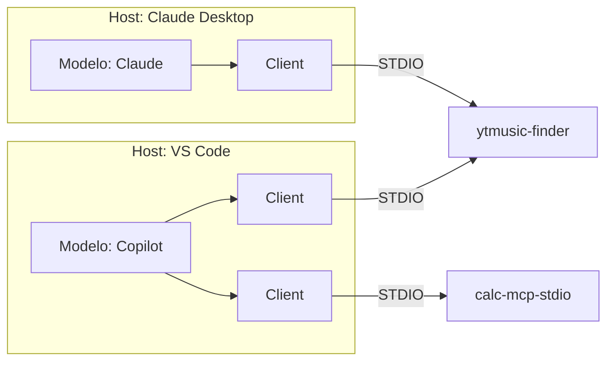

# mcp-poc

Prueba de concepto para investigar y experimentar cómo funciona el **Model Context Protocol (MCP)**: cómo se construye un servidor MCP en Python, cómo expone herramientas (*tools*) y cómo se conecta a distintos clientes de IA (VS Code + Copilot, Claude Desktop, Claude Code).

> Este proyecto es experimental y con fines de aprendizaje. No está pensado para uso en producción.

## ¿Qué es MCP?

[MCP](https://modelcontextprotocol.io/) es un protocolo abierto que estandariza cómo una aplicación de IA (el **cliente**) se comunica con programas externos (los **servidores**) que le ofrecen herramientas, recursos y prompts.

```
┌──────────────────────┐      JSON-RPC       ┌────────────────────────┐
│ Cliente MCP          │ ◀─────────────────▶ │ Servidor MCP           │
│ (Copilot, Claude...) │   stdio  o  HTTP    │ (este proyecto)        │
└──────────────────────┘                     └────────────────────────┘
        │                                               │
        │ 1. initialize                                 │
        │ 2. tools/list   → descubre las herramientas   │
        │ 3. tools/call   → el modelo decide usar una   │
        ▼                                               ▼
   El modelo de IA                              Tu código Python
```

El modelo nunca ejecuta tu código directamente: el cliente le muestra la lista de herramientas (nombre, descripción y parámetros), el modelo decide cuál llamar y con qué argumentos, y el cliente envía esa llamada al servidor.

**Transportes** que se exploran aquí:

| Transporte | Cómo funciona | Cuándo usarlo |
|---|---|---|
| `stdio` | El cliente lanza el servidor como subproceso y se comunican por stdin/stdout | Servidores locales; el cliente gestiona su ciclo de vida |
| `http` | El servidor corre por su cuenta y el cliente se conecta a una URL | Servidores remotos o compartidos |

## Servidores incluidos

Ambos están construidos con [FastMCP](https://gofastmcp.com/), que convierte funciones de Python decoradas con `@mcp.tool()` en herramientas MCP. Los *type hints* y el *docstring* de cada función son lo que el modelo ve para decidir cómo usarla.

### 🧮 Calculadora — `src/fastmcp-calculator.py`

Servidor mínimo para entender lo básico del protocolo.

| Herramienta | Parámetros | Descripción |
|---|---|---|
| `multiply` | `a`, `b` | Multiplica dos números |
| `add` | `x`, `y` | Suma dos números (ejemplo de `name`, `description` y `tags` personalizados) |
| `subtract` | `a`, `b` | Resta dos números |
| `divide` | `a`, `b` | Divide dos números; lanza un error si `b` es 0 |

### 🎵 YouTube Music Finder — `src/ytmusic-finder.py`

Servidor que consulta datos reales usando [ytmusicapi](https://ytmusicapi.readthedocs.io/). Busca por nombre de canción, álbum o artista, sin necesidad de cuenta ni API key.

| Herramienta | Parámetros | Descripción |
|---|---|---|
| `search_song` | `query`, `limit` | Busca canciones; devuelve título, artistas, álbum, duración y URL |
| `search_albums` | `query`, `max_results` | Busca álbumes; devuelve título, artistas, año y URL |

> `ytmusicapi` es una librería no oficial: puede dejar de funcionar si YouTube Music cambia su web.

### 🕸️ Music Knowledge Graph — `src/music-graph.py`

Lleva los resultados de YouTube Music a un **knowledge graph** en [Neo4j](https://neo4j.com/). En vez de devolver listas sueltas, guarda artistas, canciones y álbumes como nodos conectados, de modo que el modelo puede hacer preguntas sobre las *relaciones* ("¿con quién colaboró este artista?", "¿qué artistas están a dos grados de Bad Bunny?").

```
(:Artist {name, id})-[:PERFORMED]->(:Song {id, title, duration, url})
(:Song)-[:APPEARS_ON]->(:Album {id, title, year, url})
(:Artist)-[:RELEASED]->(:Album)
```

| Herramienta | Parámetros | Descripción |
|---|---|---|
| `ingest_songs` | `query`, `limit` | Busca canciones y las guarda con sus artistas y álbumes (`MERGE`, así que repetir no duplica) |
| `ingest_albums` | `query`, `max_results` | Busca álbumes y los guarda con sus artistas |
| `get_graph_schema` | — | Etiquetas, tipos de relación, conteos y patrones del grafo |
| `artist_network` | `artist`, `max_hops` | Artistas conectados por canciones compartidas, hasta N grados |
| `run_cypher_read` | `cypher`, `params` | Ejecuta Cypher de **solo lectura** (Neo4j rechaza escrituras); máx. 50 filas |

También expone el *prompt* `explore_artist`, que guía al agente por el flujo completo: ingerir → ver esquema → explorar colaboraciones.

## Estructura del proyecto

```
mcp-poc/
├── src/
│   ├── fastmcp-calculator.py   # Servidor MCP: calculadora
│   ├── ytmusic-finder.py       # Servidor MCP: búsqueda en YouTube Music
│   ├── music-graph.py          # Servidor MCP: knowledge graph en Neo4j
│   └── mcp_poc/                # Paquete del proyecto (placeholder)
├── .vscode/
│   └── mcp.json                # Configuración de los servidores para VS Code
├── .env.example                # Variables de conexión a Neo4j (copiar a .env)
├── pyproject.toml              # Dependencias y metadatos
└── uv.lock                     # Versiones exactas de las dependencias
```

## Arquitectura


### Diferencia entre cliente y host

Cuando se habla de la comunicación entre un cliente MCP y un servidor MCP, hay que diferenciar entre cliente y host, que a primera vista parecen el mismo término.

El host es la aplicación que utiliza el usuario final, la persona que consumirá y hará llamados a las tools del MCP por medio del modelo definido (Claude, Gemini, ChatGPT, Copilot, etc.).

El cliente MCP es un componente interno del host: cuando se inicia el host, el cliente se ejecuta por debajo para conectarse con un servidor MCP.

En cuanto a la diferencia entre agente y cliente, el agente es el modelo que se comunica con el cliente MCP para consumir las tools programadas en el servidor MCP. Es el agente quien decide qué tools utilizar, y el cliente, en segundo plano, envía la petición de uso de la tool al servidor MCP.

Cada cliente se conecta a un único servidor (relación 1:1). Con stdio, además, cada cliente lanza su propio proceso del servidor.

Cuando se inicia el host, ya sea Claude Desktop, VS Code u otro host similar, se hace la llamada `initialize` con el servidor. En ella, ambos extremos envían la información sobre quién es el cliente (`clientInfo`) y quién es el servidor (`serverInfo`), así como la versión del protocolo de comunicación y las capacidades que soporta cada uno.

Una vez establecida la comunicación, el cliente le pide al servidor sus tools, resources y prompts sin que el usuario haya hecho ninguna petición. En el momento en que el host requiere utilizar alguna capacidad del servidor, este último recibe que el host asociado está haciendo un llamado a la utilización de una tool (envía `tools/call`). Posteriormente, el servidor ejecuta la tool y responde al cliente con el resultado de la petición.

## Instalación local

### Requisitos

- **Python 3.14** o superior
- **[uv](https://docs.astral.sh/uv/)**, el gestor de paquetes y entornos usado en el proyecto

Si no tienes `uv`:

```bash
curl -LsSf https://astral.sh/uv/install.sh | sh
```

### Pasos

```bash
git clone <url-del-repositorio>
cd mcp-poc
uv sync
```

`uv sync` crea el entorno virtual `.venv/` e instala todas las dependencias con las versiones exactas de `uv.lock`. Si no tienes Python 3.14, `uv` lo descarga automáticamente.

### Neo4j (solo para `music-graph`)

```bash
docker run -d --name neo4j -p 7474:7474 -p 7687:7687 \
  -e NEO4J_AUTH=neo4j/tu-password -v neo4j-data:/data neo4j:latest

cp .env.example .env   # y pon la misma password en NEO4J_PASSWORD
```

El navegador de Neo4j queda en <http://localhost:7474> para ver el grafo (`MATCH (n) RETURN n LIMIT 100`). `.env` está en `.gitignore`.

### Comprobar que funciona

Sin conectar ningún cliente, puedes listar y llamar herramientas desde la terminal con la CLI de FastMCP:

```bash
# Ver las herramientas de un servidor
uv run fastmcp list src/fastmcp-calculator.py

# Llamar a una herramienta
uv run fastmcp call src/fastmcp-calculator.py multiply a=10 b=10
# → { "result": 100.0 }

uv run fastmcp call src/ytmusic-finder.py search_albums query="Soda Stereo" max_results=2
```

`music-graph` necesita las variables de `.env`. La CLI lanza el servidor como subproceso con un entorno filtrado, así que hay que pasarle el comando completo con `uv run --env-file`:

```bash
uv run fastmcp call \
  --command 'uv run --env-file .env fastmcp run src/music-graph.py -t stdio --no-banner' \
  --target ingest_songs --input-json '{"query": "Gustavo Cerati", "limit": 10}'
```

Para explorarlos con una interfaz web, usa el **MCP Inspector** (requiere Node.js):

```bash
uv run fastmcp dev inspector src/ytmusic-finder.py
```

## Ejecutar los servidores

**Modo stdio** (el que usan los clientes de escritorio; normalmente no lo lanzas tú, lo lanza el cliente):

```bash
uv run fastmcp run src/fastmcp-calculator.py -t stdio
uv run fastmcp run src/ytmusic-finder.py -t stdio
```

**Modo HTTP** (la calculadora lo trae configurado en su `__main__`):

```bash
uv run src/fastmcp-calculator.py
# Escuchando en http://localhost:8003/mcp
```

## Conectar un cliente

### VS Code + GitHub Copilot

El repositorio ya incluye [.vscode/mcp.json](.vscode/mcp.json) con los dos servidores (`calc-mcp-stdio` y `ytmusic-finder`).

1. Abre la carpeta del proyecto en VS Code y ejecuta `uv sync` si no lo has hecho.
2. Abre `.vscode/mcp.json` y pulsa **Start** sobre el servidor que quieras (o `Ctrl+Shift+P` → **MCP: List Servers**).
3. Abre el chat de Copilot en modo **Agent**; las herramientas aparecen en el selector de herramientas.
4. Prueba: *"Busca álbumes de Soda Stereo en YouTube Music"*.

Si algo falla: **MCP: List Servers** → servidor → **Show Output**.

### Claude Desktop

Edita el archivo de configuración de Claude Desktop:

| Sistema | Ruta |
|---|---|
| macOS | `~/Library/Application Support/Claude/claude_desktop_config.json` |
| Windows | `%APPDATA%\Claude\claude_desktop_config.json` |
| Linux | `~/.config/Claude/claude_desktop_config.json` |

Añade el servidor dentro de `mcpServers`, sustituyendo las rutas por las tuyas:

```json
{
  "mcpServers": {
    "ytmusic-finder": {
      "command": "/ruta/absoluta/a/uv",
      "args": [
        "run", "--directory", "/ruta/absoluta/a/mcp-poc",
        "fastmcp", "run", "src/ytmusic-finder.py", "-t", "stdio", "--no-banner"
      ]
    }
  }
}
```

- Usa la **ruta absoluta** de `uv` (obtenla con `which uv`): Claude Desktop no hereda el `PATH` de tu terminal.
- Cierra Claude Desktop por completo y vuelve a abrirlo; la configuración solo se lee al arrancar.
- Los logs del servidor están en la carpeta `logs/` junto al archivo de configuración (`mcp-server-ytmusic-finder.log`).

### Claude Code

Desde la raíz del proyecto:

```bash
claude mcp add ytmusic-finder -- uv run --directory "$(pwd)" fastmcp run src/ytmusic-finder.py -t stdio --no-banner
```

Para `music-graph`, añade `--env-file .env` a `uv run`:

```bash
claude mcp add music-graph -- uv run --directory "$(pwd)" --env-file .env fastmcp run src/music-graph.py -t stdio --no-banner
```

Abre una sesión nueva de Claude Code y comprueba con `/mcp` que el servidor aparece como conectado.

## Problemas conocidos

| Síntoma | Causa y solución |
|---|---|
| `TypeError: Server.__init__() takes 2 positional arguments but 3 were given` | Algunas librerías construidas sobre el SDK de MCP (como `fastapi-mcp` 0.4) no son compatibles con `mcp` 2.x. Por eso `pyproject.toml` fija `mcp<2`, que además es lo que exige `fastmcp` 3.x. |
| El cliente no encuentra `uv` | Usa la ruta absoluta del ejecutable en la configuración del cliente. |
| `music-graph`: `Unsupported authentication token, missing key credentials` | El servidor arrancó sin `NEO4J_PASSWORD`. Los clientes MCP no heredan tu entorno: usa `uv run --env-file .env`. |
| El servidor arranca pero el cliente no ve herramientas | En stdio, cualquier `print()` a stdout corrompe el protocolo. Usa `--no-banner` y escribe los logs en stderr. |

## Recursos

- [Especificación de MCP](https://modelcontextprotocol.io/)
- [Documentación de FastMCP](https://gofastmcp.com/)
- [Cypher Manual](https://neo4j.com/docs/cypher-manual/current/) y [driver de Python para Neo4j](https://neo4j.com/docs/python-manual/current/)
- [GraphAcademy de Neo4j](https://graphacademy.neo4j.com/) (cursos gratuitos)
- [Documentación de ytmusicapi](https://ytmusicapi.readthedocs.io/)
- [MCP en VS Code](https://code.visualstudio.com/docs/copilot/chat/mcp-servers)
- [Python Course sobre MCP con freecodeCamp](https://www.youtube.com/watch?v=DosHnyq78xY)
